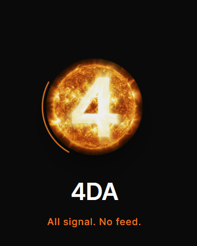
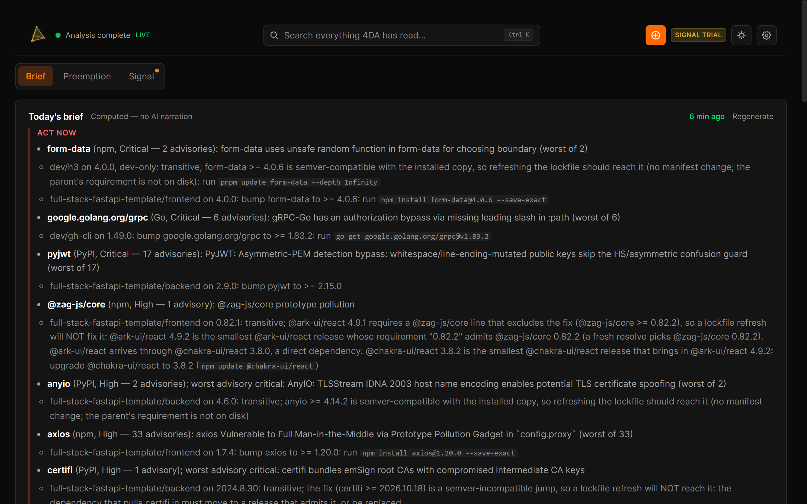
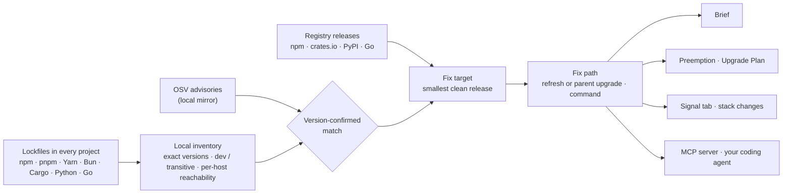
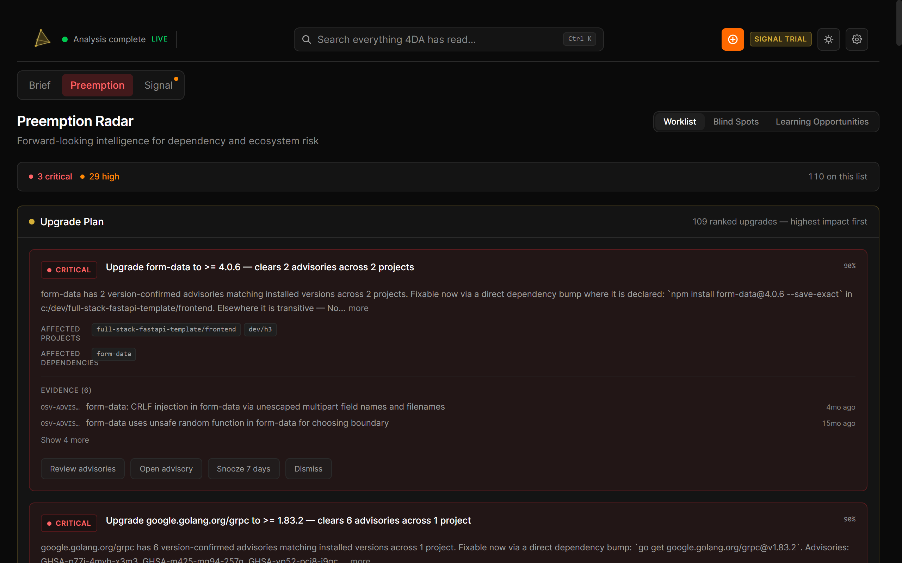
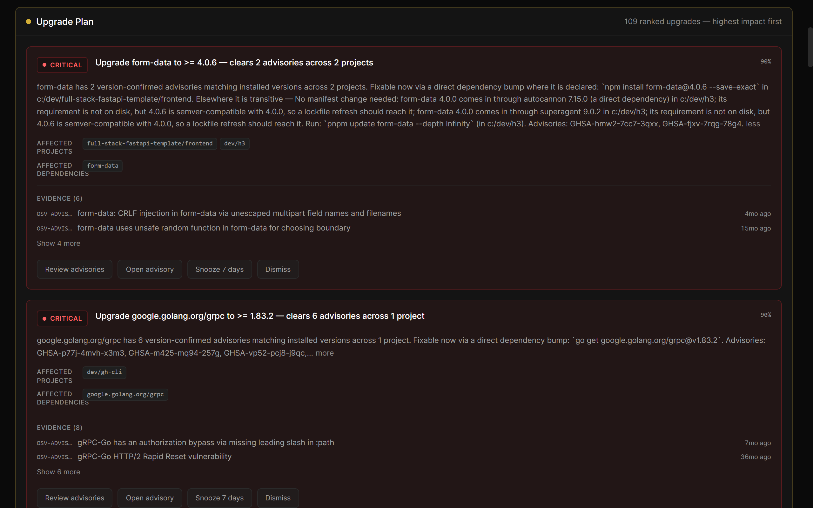
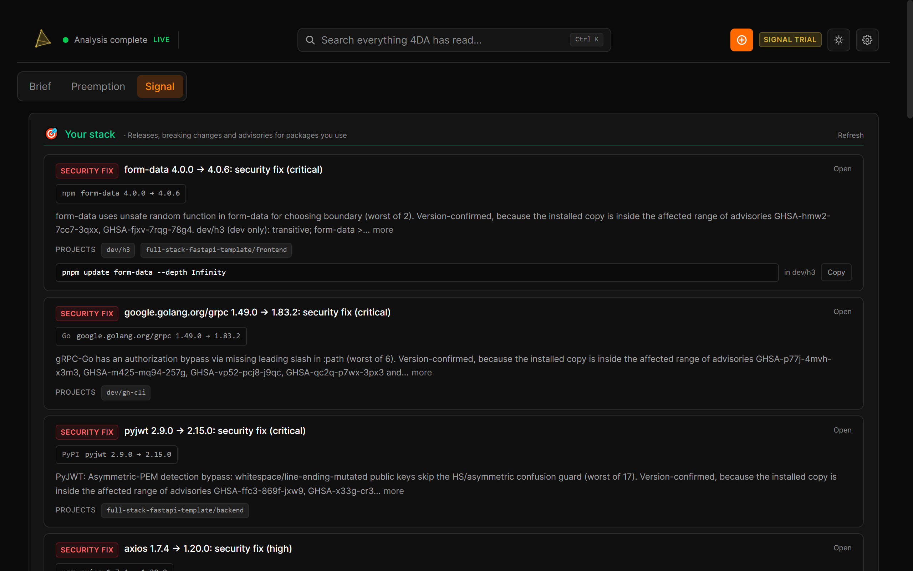

<div align="center">



<br />

**4DA knows every dependency on your machine and tells you — and your coding agent — what changed and exactly what to run. Privately, locally.**

[](https://github.com/4DA-Systems/4DA/actions/workflows/validate.yml)
[](https://www.npmjs.com/package/@4da/mcp-server)
[](https://github.com/4DA-Systems/4DA/releases/latest)
[](#license)

[Quick start](#quick-start) · [How it works](#how-it-works) · [Measured](#measured-not-asserted) · [Privacy](#what-leaves-your-machine) · [Pricing](#pricing) · [4da.ai](https://4da.ai)

</div>

<p align="center">
  
</p>

<sub>Every screenshot on this page is the current build (<code>main</code>) on a demo machine: five public projects at older pinned releases — ripgrep 12.0.0, Pake 2.3.0, full-stack-fastapi-template 0.8.0, GitHub CLI 2.20.0 and h3 1.12.0 — whose lockfiles come from the <a href="src-tauri/tests/conformance/">conformance corpus</a>. The findings are what 4DA reports for those releases today, against live OSV data.</sub>

It reads npm, pnpm, Yarn, Bun, Cargo, Python and Go lockfiles today, with early support for Ruby and PHP; Maven, Gradle and .NET projects are not covered yet.

## What it tells you

Most dependency tools stop at the alert. 4DA carries each finding through to the command.

- **Only what is installed.** An advisory counts when the exact version in your lockfile falls inside its affected range. Dev-only and transitive copies are labelled, and a Rust crate your build never compiles on this host is marked unreachable instead of urgent.
- **The fix, not the alert.** Each finding names the smallest release that clears every known advisory on that package, skipping yanked and deprecated releases and any release that pins a still-vulnerable dependency. A new release waits three days before 4DA suggests upgrading to it, so a compromised publish can be caught and pulled first.
- **How the fix lands.** For a transitive copy, 4DA reads the lockfile edge or the parent's installed manifest to decide whether a lockfile refresh reaches the fix or which direct dependency has to move, and names the command (`pnpm update --depth Infinity`, `npm update`, `yarn up -R`, `cargo update --precise`). When only semver rules are left to go on, it says so.
- **Every project at once.** One inventory across every lockfile on the machine. The Upgrade Plan ranks the fixes by how many advisories each one clears.
- **Your coding agent asks first.** The free [MCP server](https://github.com/4DA-Systems/4da-mcp-server) answers "is this version safe to write?" before an agent edits a manifest, and tells it what an upgrade breaks and which of your files import the package.

From the screenshot above: `@zag-js/core` 0.82.1 has an advisory, but its parent `@ark-ui/react` 4.9.1 requires a line that excludes the fix, so a lockfile refresh will not reach it. 4DA traces the chain to the direct dependency and says what to do: upgrade `@chakra-ui/react` to 3.8.2, the smallest release that brings in a fixed copy.

## Quick start

### For your coding agent — free, Apache-2.0, no account

```bash
claude mcp add 4da -- npx @4da/mcp-server     # Claude Code
npx @4da/mcp-server --setup                   # Cursor, VS Code, Windsurf, Claude Desktop, Devin
```

Needs Node.js 22 or later. It works on its own, with no desktop app, no API key and no account. This is a `dependency_check` answer from 2026-11-05, condensed from the tool's JSON:

```text
axios 1.7.4   (npm)        AVOID    33 advisories affect 1.7.4. Safe on 1.x: 1.20.0, 1.21.0
pyjwt 2.9.0   (PyPI)       AVOID    no 2.9.x release is clear. Newest safe: 2.15.1
tokio 1.x     (crates.io)  PROCEED  1.54.1. 129 of the 132 releases in 1.x are affected;
                                    safe: 1.51.6, 1.53.3, 1.54.1
```

Sixteen tools in all: 11 standalone (`dependency_check`, `upgrade_impact`, `vulnerability_scan`, `upgrade_planner`, `dependency_health`, `what_should_i_know` and more), plus 5 that read the desktop app's data. [Full reference.](https://github.com/4DA-Systems/4da-mcp-server#all-16-tools)

### For you — the desktop app

| Platform | Download | Updates |
|---|---|---|
| **Windows** 10 / 11 (x64) | [`.exe` installer](https://github.com/4DA-Systems/4DA/releases/latest) | In-app |
| **macOS** 10.15+ | [`.dmg`, separate Apple Silicon and Intel builds](https://github.com/4DA-Systems/4DA/releases/latest) | In-app |
| **Linux** x86_64 (Ubuntu 22.04+, WebKitGTK 4.1) | [`.AppImage` / `.deb` / `.rpm`](https://github.com/4DA-Systems/4DA/releases/latest) | Notice with a download link |

> **The current release, v1.0.3 (5 October 2026), predates the redesign on this page.** It has four tabs, reads news from every source by default and bundles the search model. The dependency-first build shown here ships as v1.0.4, which is being prepared (see the [changelog](CHANGELOG.md)); until it is published, [build from source](#build-from-source) to run it. On Intel Macs, v1.0.4 has no built-in local embeddings (Ollama works).

No account, no card. Open the app, point it at the folders that hold your projects, and read the Brief.

## Why your agent needs it

Coding agents choose dependency versions from training data that is months old. We measured what that costs. In 46 dependency tasks (add, upgrade or pin a package across npm, PyPI, crates.io and Go), with three runs each, Claude Sonnet 5.5 in headless Claude Code chose a version with a known advisory in **82 of 138** runs. With the 4DA MCP server attached, it did so in **0 of 138** (Fisher's exact p ≈ 9 × 10⁻³³).

Both arms had shell and web access turned off. That is the situation the server is for: an agent that cannot check a registry itself. The analysis plan was written before the full run. Truth came from OSV and the registries directly, never from the server under test. The last run was on the 6.2.6 release candidate on 2026-10-29. The harness, the preregistration, the pinned truth and the scored results are public in [`4da-mcp-server/bench/g7`](https://github.com/4DA-Systems/4da-mcp-server/tree/main/bench/g7), so you can re-run it.

## How it works



1. **Find.** 4DA walks the folders you give it and reads every lockfile it supports: `Cargo.lock`, `package-lock.json`, `npm-shrinkwrap.json`, `pnpm-lock.yaml`, `yarn.lock` (classic and Berry), `bun.lock`, `poetry.lock`, `uv.lock`, `pdm.lock`, `Pipfile.lock`, `requirements*.txt` and `go.mod`/`go.sum`, plus early `Gemfile.lock` and `composer.lock`. Files it cannot read yet (`bun.lockb`, Maven, Gradle, .NET, Dart, CocoaPods, SwiftPM, Elixir, conda) are listed as not covered, never silently dropped.
2. **Match.** Advisories come from a local mirror of OSV, re-synced once it is more than six hours old, so checks keep working offline. A result is only called clear when that mirror is fresh. When it is not, the answer is "unknown". Malicious-package reports (OSV `MAL-` entries) are flagged as "remove or replace", with no version to upgrade to.
3. **Fix.** The target and the route are computed by one set of rules, shared by the app and the MCP server and held equal by [454 rule vectors](src-tauri/tests/conformance/vectors/) that both run in CI. The rules are being extracted into a pure Rust crate, [`fourda-depengine`](crates/fourda-depengine/), which already compiles to WebAssembly and gives the same answers as the native build.
4. **Tell.** Three tabs show the same facts:
   - **Brief** answers "anything I need to do today?"
   - **Preemption** is the worklist, with the Upgrade Plan. Blind Spots and Knowledge Gaps are views inside it.
   - **Signal** shows what changed in your stack: security fixes and releases for the packages you actually have.

## Measured, not asserted

| What | How it is measured | Result | Check it yourself |
|---|---|---|---|
| Lockfile reading and matching | 36 cases (32 public repositories at pinned commits plus 4 synthetic), 13 lockfile formats in 22 versions, vendored lockfiles, pinned OSV records, adjudicated truth | Precision and recall 1.0 for findings and inventory in every ecosystem; 0 silent drops. CI fails on any fall. | `cargo test --lib osv::conformance_tests` · [corpus](src-tauri/tests/conformance/) |
| Fix paths | 22 recommended actions in 9 public repositories, each applied, re-resolved and re-scanned with osv-scanner | 21 / 22 clear the advisory with a minimal change (95.5%; the launch bar is 95%); no recommended target is still affected by an advisory that has a fix | Method in [AD-055](.ai/DECISIONS.md); the rules it settled (fix target, refresh verdict, parent release, command) are pinned by [rule vectors](src-tauri/tests/conformance/vectors/) in CI |
| Agent safety | Preregistered A/B with headless Claude Code, above | 82 / 138 → 0 / 138 runs choosing a vulnerable version | [`bench/g7`](https://github.com/4DA-Systems/4da-mcp-server/tree/main/bench/g7) in the MCP repo |
| Engine parity | The Rust rules compiled to WebAssembly vs native | Identical on 354 / 354 requests | `crates/fourda-depengine` CI |

About 9,000 tests run in CI on every change: roughly 6,850 Rust, 180 in the engine crate and 1,960 frontend.

## Screenshots

<p align="center">
  
  <br />
  <em>Preemption — the Upgrade Plan ranks every fix across your projects by the advisories it clears.</em>
</p>

<p align="center">
  
  <br />
  <em>The fix path — a transitive copy traced to the direct dependencies that bring it in, and why a lockfile refresh is enough.</em>
</p>

<p align="center">
  
  <br />
  <em>Signal — what changed in your stack, each with a command you can copy.</em>
</p>

## What leaves your machine

4DA has no analytics, no telemetry, no crash reporting and no user accounts, and 4DA runs no server that receives your projects or your results. The database lives on your machine. Your source code and file contents never leave it. Cloud embeddings are the one exception, and they are opt-in ([NETWORK.md §2a](NETWORK.md#2a-byok-cloud-llm-relevance-judging)).

| What | Where | What it receives |
|---|---|---|
| Dependency checks | OSV's public archive bucket; npm, crates.io, PyPI and the Go module proxy | Advisory matching sends nothing about your dependencies: the OSV archive is downloaded and matched on your machine. Release checks send package names (never versions) to the registries; Settings → Privacy → Registry lookups turns them off, and private names (`GOPRIVATE` modules, private `.npmrc` scopes and registries, git / path / non-crates.io crates, packages from another Python index) are never sent ([NETWORK.md §2o](NETWORK.md#2o-registry-lookups-switch-and-private-package-names)). Never your code. |
| Online check and price table | `api.github.com`, `dns.google`, `1.1.1.1`, `httpbin.org`, Hacker News; GitHub raw | A `HEAD` request before each fetch cycle to see whether you are online; the model price list at most once a day. No user data. |
| News sources | Only the interests you turn on (all off on a new install) | Plain requests for public content. Reddit, Stack Overflow and GitHub search see the subreddits, tags and languages you follow. |
| AI provider | Only one you set up with your own key: Anthropic, OpenAI, any OpenAI-compatible endpoint, or local Ollama | Item titles and snippets (capped at 2,000 characters; Settings → Privacy can send titles only), dependency names, and for the AI-written Brief installed and fix versions, project labels, git-derived topics, interests and the titles of saved items. File paths become project labels. Never source code or commit messages. |
| Licence | `4da.ai` (paid licences only) | Current keys are checked offline. A monthly or annual key goes to `4da.ai` near expiry to renew; a lifetime key contacts nothing. Your email, only if you use "Recover License by Email". Older Keygen-format keys are validated at `api.keygen.sh`. |
| Updates | GitHub Releases | One request for the update manifest per session; updates are minisign-verified. |
| One-time downloads | Hugging Face; GitHub | The local search model (~262 MB, SHA-256 pinned), only when a feature first needs it (v1.0.3 bundles it instead); the ONNX Runtime library only if it is missing. |
| Crash reports | **None** | Export a scrubbed diagnostic bundle locally, on demand. |

[NETWORK.md](NETWORK.md) is the complete list, with source references, the opt-in flows and the local-only Signal Terminal port. On Windows, the WebView2 runtime that draws the window also contacts Microsoft on its own; [NETWORK.md §5](NETWORK.md#5-not-4das-code-the-windows-webview-runtime) explains how to limit it. Also: [Trust architecture](docs/TRUST-ARCHITECTURE.md) · [Privacy in plain language](docs/PRIVACY-PLAIN-LANGUAGE.md) · [Security audit guide](docs/SECURITY-AUDIT-GUIDE.md) · [Build and verify it yourself](docs/BUILD-FROM-SOURCE.md).

## Pricing

**Free** — no account, no card, no expiry.
- Version-confirmed findings for every project on your machine, each with the version that clears it and how the fix lands
- The Brief, computed from your lockfiles (written by AI if you add a capable model)
- Security fixes in the Signal tab
- The MCP server (16 tools) and the CLI
- Optional news reading ("interests") with 30 days of history; natural-language search (top 3 results)

**Signal** — $12 AUD a month, $99 AUD a year, or $299 AUD once for a lifetime licence (tax included). A 14-day trial starts on first launch, no card. Signal sells time saved on upgrades.
- The in-app Upgrade Plan: every fix across your projects in one ranked list
- The full Preemption worklist: AI-assessed findings and early-warning chains on top of the free floor
- Releases and breaking changes in the Signal tab, not only security fixes
- History beyond 30 days (up to your retention setting, at most 365), watches, and 5-minute monitoring
- Blind Spots and Knowledge Gaps, as supporting views

Free is not a demo: every version-confirmed vulnerability and its fix is free, in the app and through the MCP server.

## Install details

**Verifying downloads.** Every release publishes `SHASUMS256.txt` and a `.sha256` file per asset ([how to verify](docs/VERIFY-DOWNLOADS.md)), plus SBOMs for the npm and Rust dependency trees.

**Signing.** The macOS app is signed with an Apple Developer ID and notarized. The Windows installer is not yet Authenticode-signed, so SmartScreen shows "Unknown publisher": check the SHA-256 against `SHASUMS256.txt`, then choose **More info → Run anyway** ([details](docs/launch/WINDOWS-INSTALL.md)). The standalone `4da-cli-*` binaries are not code-signed on any platform. The Windows and Linux installers and the macOS update bundle carry a minisign signature from the 4DA release key; the `.dmg` and the CLI binaries do not. [SECURITY.md](SECURITY.md#update-mechanism-and-release-signing) has the full table.

**System requirements.**
- **The dependency engine** needs any 64-bit CPU, 4 GB of RAM, no GPU, no API key and no model download.
- **A written Brief** needs a Sonnet- or GPT-4-class model with your own key, or a ~70B-class local model through Ollama. Without one, the Brief is computed from the facts, with no AI narration.
- **Private semantic search** (for interests and natural-language search) runs on your machine with nomic-embed-text v1.5, downloaded once when first needed.
- **Disk use** grows with your history. Default retention is 30 days, adjustable from 7 to 365. Before each schema upgrade 4DA copies the database and keeps the two most recent copies.

<details>
<summary><strong>CLI</strong></summary>

A separate `4da-cli-<target>` download on each release. It reads the desktop app's database; every command takes `--json`.

```bash
4da briefing              # The latest stored Brief
4da signals               # Recent news items matching your stack (--critical for critical/high)
4da gaps                  # Dependencies no news item has covered
4da health                # Per-project dependency counts and languages
4da status                # Database stats
```

</details>

<details>
<summary><strong>Reading developer news (optional "interests")</strong></summary>

4DA can also read 16 news and community sources: Hacker News, Lobsters, Reddit, Mastodon, Lemmy, Bluesky, DEV, GitHub, Hugging Face, arXiv, Papers with Code, Stack Overflow, Product Hunt, YouTube, X (with your own API key) and any RSS feed. They are **off on a new install** and serve the engine; the product is the dependency work above. Six sources stay on because the engine needs them: crates.io, npm, PyPI, Go modules, OSV and CVE.

When interests are on, each item is scored against your projects on four axes: semantic similarity to your code, your declared interests, recent git activity, and your installed packages. A fifth axis, learned preference, is reserved and does not score. An item normally needs two axes to agree. A strong match on one of your own packages, a security advisory confirmed against a dependency, or a breaking release of a runtime dependency can pass on its own. A single weaker axis is capped at 28%. A dozen quality multipliers (novelty, depth, title–body coherence, competing technologies, freshness and others) follow. With a model configured, an LLM then grades the top items on a 1–5 rubric. When the engine improves, it re-judges everything it already holds: yesterday's noise becomes tomorrow's signal.

The scoring is benchmarked on a 245-item labelled corpus across 9 simulated developer personas (1,997 scored evaluations):

```bash
cd src-tauri
cargo test --lib scoring::simulation -- --nocapture
```

On the current pipeline: precision 88.1%, recall 35.8%, F1 0.510, noise correctly rejected 99.0%, and 93.2% of items rejected overall. Recall is low by design: most of the "relevant" labels are tangential items a precision-first feed drops. Recall on the strongly relevant items — security advisories and releases for declared dependencies — is 71.3% (72 of 101). CI fails if aggregate precision drops below 0.76 or F1 below 0.45, or if any persona lets through more than 20% of a noise category. Source: [`src-tauri/src/scoring/simulation/`](src-tauri/src/scoring/simulation/).

</details>

## Build from source

```bash
git clone https://github.com/4DA-Systems/4DA.git
cd 4DA
pnpm install
pnpm tauri dev        # dev server on localhost:4444; the first build takes a while
```

**Prerequisites:** Rust 1.95.0 (pinned in `src-tauri/rust-toolchain.toml`), Node.js 22, pnpm 10.34.6 (pinned by `packageManager`; `corepack enable` picks it up). On Windows, VS Build Tools 2022 with the C++ workload. [Full build guide](docs/BUILD-FROM-SOURCE.md) · [Getting started](docs/GETTING_STARTED.md)

| Layer | Technology |
|---|---|
| App shell | Tauri 2 (Rust backend, system WebView) |
| Frontend | React 19, TypeScript, Tailwind CSS 4 |
| Database | SQLite 3.53 (bundled) with sqlite-vec |
| Dependency rules | `crates/fourda-depengine` — pure Rust, no I/O, builds for native and wasm32 |
| Embeddings | nomic-embed-text v1.5, run in-process (fastembed) or through Ollama |
| Models (optional) | Anthropic, OpenAI, any OpenAI-compatible endpoint, or Ollama — your key, your compute |

```bash
cargo test --lib            # Rust tests (from src-tauri/)
pnpm test                   # Frontend tests
pnpm validate:all           # Lint, types, tests and build
```

4DA is built by one engineer working with AI coding agents. Every change passes the gates above and the CI suite; external model audits are recorded in the commit history.

## License

The desktop app is source-available under the [Functional Source License](LICENSE) (FSL-1.1 with Apache 2.0 as the future licence), modified so that each release becomes Apache 2.0 three years after it is published. You may use, study, modify and redistribute it for any purpose except a competing use: offering it, or something built from it, to others as a commercial product or service that substitutes for 4DA. See [LICENSE](LICENSE) for the exact terms. The [MCP server](https://github.com/4DA-Systems/4da-mcp-server) is Apache-2.0.

---

<div align="center">

**4DA** — *4 Dimensional Autonomy* · All signal. No feed.

"4DA" and the 4DA logo are trademarks of 4DA Systems Pty Ltd (ACN 696 078 841). Neither licence grants rights to use them.

</div>
